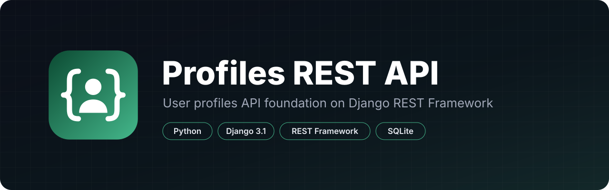
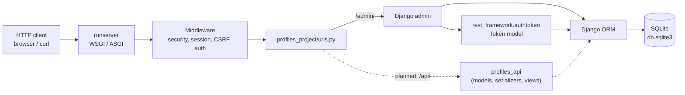

<div align="center">
  
  <p><b>A clean Django 3.1 + Django REST Framework foundation for a user profiles API, with token authentication wired in.</b></p>

  <p>
    
    
    
    
    <a href="LICENSE"></a>
    
    
    
  </p>

  <p><a href="#-quick-start">Quick start</a> · <a href="#-features">Features</a> · <a href="#-architecture">Architecture</a> · <a href="#-contributing">Contributing</a></p>
</div>

## Overview

**Profiles REST API** is the foundation of a user profiles service built with Django and Django REST Framework (DRF). It provides a configured Django 3.1 project, a dedicated `profiles_api` app, DRF and DRF token authentication registered in `INSTALLED_APPS`, and the Django admin for managing users and API tokens.

It is a learning project and reference starting point: the project skeleton, settings and auth plumbing are in place, and the profile model, serializers and REST endpoints are the next milestones on the [roadmap](#-roadmap).

## ✨ Features

- **Django 3.1 project** (`profiles_project`) with SQLite configured out of the box.
- **Dedicated API app** (`profiles_api`) registered and ready for models, serializers and views.
- **Django REST Framework installed** (`rest_framework`), so DRF views, viewsets and the browsable API can be added without further setup.
- **Token authentication app** (`rest_framework.authtoken`) installed; its migration creates the token table and its admin lets you issue tokens per user.
- **Django admin** at `/admin/` for managing users, groups and auth tokens.
- **Standard security middleware** (CSRF, clickjacking protection, sessions, authentication) and Django's four default password validators.

## 🧱 Tech stack

| Layer | Technology |
| --- | --- |
| Language | Python 3.8 |
| Web framework | Django 3.1 |
| API toolkit | Django REST Framework |
| Authentication | Django sessions (admin), DRF token auth (`rest_framework.authtoken`) |
| Database | SQLite (`db.sqlite3`, created on first migrate) |
| Server | Django development server (`manage.py runserver`); WSGI and ASGI entry points included |

## 🏗 Architecture



Solid lines are implemented today; dotted lines are the planned API layer.

```text
profiles_project/       # Django project: settings, root URLconf, WSGI/ASGI
profiles_api/           # API app: models, views, admin, tests (to be implemented)
manage.py               # Django management entry point
```

## 🚀 Quick start

### Prerequisites

- Python 3.8 or 3.9 (Django 3.1 does not run on Python 3.12+)
- `pip` and `venv`

### Clone

```bash
git clone https://github.com/ismailbentabett/profiles-rest-api-django.git
cd profiles-rest-api-django
```

### Create a virtual environment and install dependencies

The repository does not ship a `requirements.txt`; install the packages the settings expect:

```bash
python -m venv .venv
# Windows: .venv\Scripts\activate
source .venv/bin/activate
pip install "Django>=3.1,<3.2" "djangorestframework>=3.12,<3.15"
```

> The tracked `project_env/` folder contains only the Windows launcher scripts from the original development machine, not the installed packages. Create a fresh environment as shown above.

### Migrate, create an admin user and run

```bash
python manage.py migrate
python manage.py createsuperuser
python manage.py runserver
```

The server listens on `http://127.0.0.1:8000/`. Sign in to the admin at `http://127.0.0.1:8000/admin/`.

### Issue an API token

```bash
python manage.py drf_create_token <username>
```

Tokens can also be created in the admin under **Auth Token > Tokens**.

## API reference

### Routes

These are the routes defined in `profiles_project/urls.py` today:

| Method | Path | Auth | Description |
| --- | --- | --- | --- |
| `GET` | `/admin/` | Django session (staff user) | Admin dashboard; redirects to the login page when not signed in |
| `GET`, `POST` | `/admin/login/` | None (submits credentials) | Admin login form |
| `GET`, `POST` | `/admin/<app>/<model>/...` | Django session (staff user) | Admin CRUD for users, groups and auth tokens |

No REST endpoints are exposed by `profiles_api` yet. See the [roadmap](#-roadmap) for the planned profile and login endpoints.

### Authentication

- **Admin:** Django session authentication. Sign in at `/admin/login/` with a staff or superuser account.
- **API (for upcoming endpoints):** `rest_framework.authtoken` is installed, so clients will authenticate with an `Authorization: Token <key>` header once token authentication is enabled on the API views. No `REST_FRAMEWORK` settings block is defined yet, so DRF's defaults (session and basic authentication) apply to any DRF view until it is configured.

### Examples

Check that the server is up (an anonymous request to the admin returns a `302` redirect to the login page):

```bash
curl -i http://127.0.0.1:8000/admin/
```

Load the admin login form:

```bash
curl -i http://127.0.0.1:8000/admin/login/
```

Once API endpoints are added, authenticate with a token issued by `drf_create_token`:

```bash
curl -H "Authorization: Token <your-token>" http://127.0.0.1:8000/api/...
```

## ⚙️ Configuration

The project does not read environment variables yet. All configuration lives in `profiles_project/settings.py`:

| Setting | Current value | Notes |
| --- | --- | --- |
| `SECRET_KEY` | Hard-coded development key | Replace and load from the environment before any deployment |
| `DEBUG` | `True` | Set to `False` in production |
| `ALLOWED_HOSTS` | `[]` | Add your host names in production |
| `DATABASES` | SQLite at `BASE_DIR / 'db.sqlite3'` | `db.sqlite3` is git-ignored |
| `TIME_ZONE` | `UTC` | |

## 📁 Project structure

```text
profiles-rest-api-django/
├── .github/                 # issue/PR templates and branding assets
├── profiles_api/            # API app (admin, apps, models, views, tests, migrations)
├── profiles_project/
│   ├── settings.py          # installed apps, middleware, database, auth validators
│   ├── urls.py              # root URLconf (/admin/)
│   ├── wsgi.py              # WSGI entry point
│   └── asgi.py              # ASGI entry point
├── project_env/             # Windows venv launcher scripts from the original setup
├── manage.py                # Django management commands
└── README.md
```

## 🗺 Roadmap

- [x] Django project and `profiles_api` app scaffolded
- [x] Django REST Framework and token auth installed
- [ ] Custom `UserProfile` model (email as username) with a custom manager
- [ ] `UserProfile` serializer with write-only, hashed passwords
- [ ] `ModelViewSet` for profiles under `/api/profile/` with search by name and email
- [ ] Permission so users can only update their own profile
- [ ] Token login endpoint (`/api/login/`) using `ObtainAuthToken`
- [ ] `requirements.txt` with pinned versions
- [ ] Move `SECRET_KEY`, `DEBUG` and `ALLOWED_HOSTS` to environment variables
- [ ] Unit tests for models and API endpoints

## 🤝 Contributing

Contributions are welcome. Read [CONTRIBUTING.md](CONTRIBUTING.md) for the workflow, and follow the [Code of Conduct](CODE_OF_CONDUCT.md).

## 🔒 Security

Please report vulnerabilities privately as described in [SECURITY.md](SECURITY.md).

## 📄 License

Released under the [MIT License](LICENSE).

---

<div align="center">
  <p>Built by <b>Ismail Bentabett</b> · <a href="https://github.com/ismailbentabett">GitHub</a> · <a href="https://ismailbentabett.com">ismailbentabett.com</a></p>
  <p>⭐ Star this repo if you find it useful</p>
</div>
